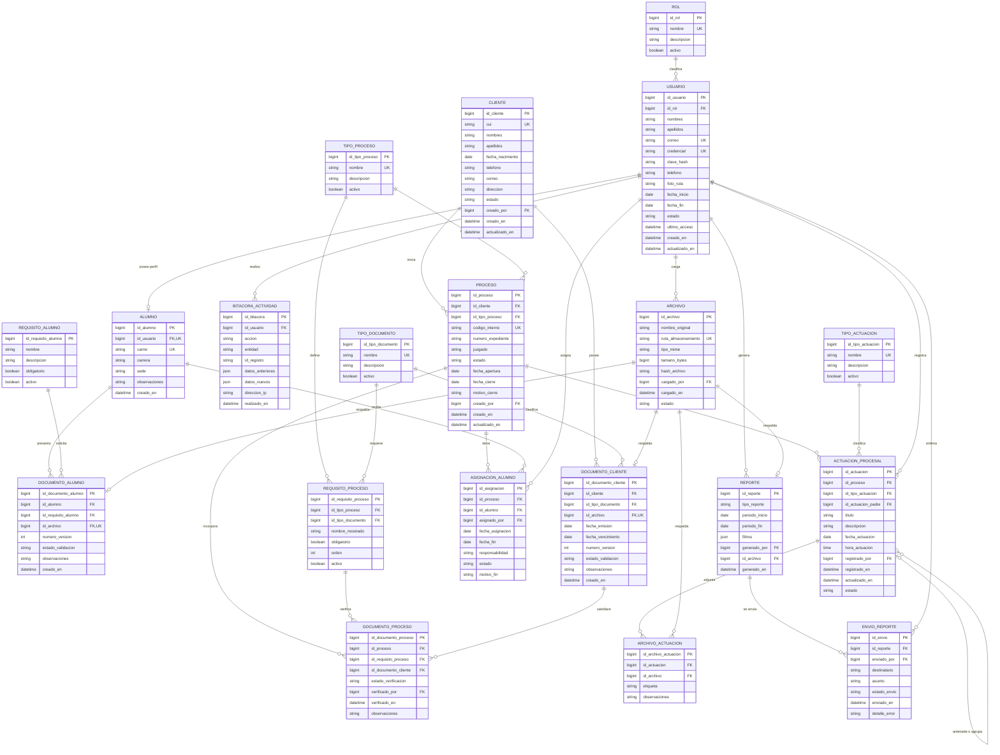

# [NO VIGENTE] Definición funcional y modelo entidad–relación del MVP

> **Documento retirado de la definición actual.** El equipo solicitó olvidar el
> ERD anterior y volver a los requerimientos de la reunión. No usar este archivo
> como fuente funcional. La referencia vigente es
> [`../requerimientos/06_CONTEXTO_REUNION.md`](../requerimientos/06_CONTEXTO_REUNION.md).

## Clínica Jurídica UMG

**Estado:** propuesta para validación con el cliente  
**Propósito:** definir el alcance, las reglas de negocio y la estructura de información antes de diseñar interfaces o desarrollar el sistema.

---

## 1. Objetivo del MVP

El MVP permitirá administrar, en un único sistema interno:

- usuarios, roles y períodos de participación;
- alumnos y su papelería;
- clientes y su expediente documental;
- procesos judiciales y sus requisitos;
- asignación de uno o varios alumnos a cada proceso;
- seguimiento cronológico de memoriales, revisiones, presentaciones, notificaciones y otros pasos;
- búsqueda de clientes y alumnos;
- trazabilidad de las acciones realizadas;
- generación, impresión y envío de reportes.

El sistema será utilizado únicamente por personal autorizado de la clínica jurídica. Los clientes atendidos no tendrán cuenta ni acceso.

---

## 2. Decisiones de modelado

1. **Un alumno también es un usuario del sistema.** `ALUMNO` amplía la información de `USUARIO` en una relación uno a uno.
2. **Un cliente puede tener varios procesos.** Cada proceso pertenece a un cliente titular y a un tipo de proceso.
3. **Un proceso puede tener varios alumnos, incluso en distintos períodos.** La entidad `ASIGNACION_ALUMNO` conserva el historial de asignaciones.
4. **Los documentos del cliente no se duplican al abrir un proceso.** Se vinculan al proceso mediante `DOCUMENTO_PROCESO`, dejando constancia de cuál versión satisfizo cada requisito.
5. **Todo archivo físico se registra una sola vez en `ARCHIVO`.** Las demás entidades describen su uso y contexto.
6. **El seguimiento judicial se modela como una línea de tiempo.** Cada `ACTUACION_PROCESAL` puede enlazarse con otra actuación anterior. Esto permite relacionar una revisión o presentación con su memorial.
7. **La trazabilidad no depende solamente de fechas de creación.** `BITACORA_ACTIVIDAD` registra quién hizo qué, cuándo y sobre qué registro.
8. **Cerrar la participación de un alumno no elimina sus casos.** Los procesos pertenecen al cliente y deben conservar su historia, aunque el alumno ya no esté activo.
9. **La eliminación física será excepcional.** Antes de implementarla deben definirse el período legal de conservación, los respaldos y qué información puede eliminarse.

---

## 3. Diagrama entidad–relación propuesto

### Lectura rápida del diagrama

- `CLIENTE → PROCESO`: un cliente puede tener cero o muchos procesos.
- `TIPO_PROCESO → REQUISITO_PROCESO`: cada uno de los aproximadamente 25 tipos configura su propia lista documental.
- `PROCESO ↔ ALUMNO`: es una relación muchos a muchos resuelta por `ASIGNACION_ALUMNO`.
- `PROCESO → ACTUACION_PROCESAL`: todas las acciones forman la línea de tiempo del expediente.
- `ACTUACION_PROCESAL → ACTUACION_PROCESAL`: una revisión o presentación puede apuntar al memorial al que corresponde.
- `ARCHIVO`: centraliza la información técnica de PDF e imágenes sin mezclarla con su significado jurídico.
- `BITACORA_ACTIVIDAD`: conserva la auditoría transversal de altas, cambios, consultas sensibles, descargas, envíos y cierres.

---

## 4. Catálogos iniciales

### Roles

| Código | Rol | Alcance |
|---|---|---|
| `ADMIN_GENERAL` | Administrador general | Acceso total, incluida la administración y desactivación de usuarios |
| `SECRETARIA` | Secretaría | Operación completa, excepto eliminar o desactivar usuarios |
| `ALUMNO` | Alumno | Consulta de sus casos asignados y registro de actividades según autorización |

> Se recomienda desactivar usuarios en vez de eliminarlos, para no romper la trazabilidad histórica.

### Estados de usuario

`PENDIENTE`, `ACTIVO`, `INACTIVO`, `BLOQUEADO`.

### Estados de proceso

`BORRADOR`, `ABIERTO`, `EN_TRAMITE`, `SUSPENDIDO`, `CERRADO`, `ARCHIVADO`.

### Tipos de actuación iniciales

`APERTURA`, `MEMORIAL`, `REVISION_MEMORIAL`, `PRESENTACION_MEMORIAL`, `NOTIFICACION`, `AUDIENCIA`, `RESOLUCION`, `GESTION_INTERNA`, `CIERRE`, `OTRO`.

Una revisión y una presentación se registran como actuaciones independientes, con su propia fecha, usuario y archivos, y se vinculan al memorial mediante `id_actuacion_padre`.

### Estados de validación documental

`PENDIENTE`, `VALIDO`, `RECHAZADO`, `VENCIDO`, `REEMPLAZADO`.

---

## 5. Reglas de negocio principales

### Usuarios y permisos

1. Todo usuario debe tener exactamente un rol en el MVP.
2. El administrador y las secretarías pueden crear y modificar usuarios; solo el administrador general puede bloquearlos, desactivarlos o ejecutar una eliminación autorizada.
3. Ningún usuario con actividad histórica debe eliminarse físicamente.
4. La `fecha_fin` no puede ser anterior a la `fecha_inicio`.
5. Un usuario inactivo o fuera de su período no puede iniciar sesión.
6. Un alumno debe tener un perfil `ALUMNO` y un carné único.
7. Los permisos deben validarse en cada operación, no solamente ocultando botones.

### Clientes y documentos

8. El CUI/DPI debe ser único cuando haya sido informado. Debe permitirse registrar temporalmente a una persona sin CUI, si el negocio lo necesita.
9. Un cliente puede tener varias versiones del mismo tipo de documento.
10. Reemplazar un documento no borra la versión anterior; la marca como `REEMPLAZADO`.
11. Los formatos admitidos en el MVP serán PDF, JPG, JPEG y PNG, con un tamaño máximo configurable.
12. El sistema debe calcular una huella digital (`hash_archivo`) para detectar duplicados y evidenciar alteraciones.
13. Los archivos no se expondrán mediante rutas públicas; toda descarga requerirá autenticación y permiso.

### Procesos y asignaciones

14. Un proceso pertenece a un solo cliente titular en el MVP.
15. El código interno del proceso debe ser único.
16. Al seleccionar el tipo de proceso se carga su lista vigente de requisitos.
17. Un requisito puede ser obligatorio u opcional.
18. El proceso puede abrirse con requisitos pendientes, pero el sistema debe mostrar claramente el porcentaje o estado de completitud.
19. Un documento del cliente puede satisfacer requisitos de más de un proceso, pero cada vínculo se verifica por separado.
20. Solo puede existir una asignación activa para la misma combinación alumno–proceso.
21. Finalizar una asignación no elimina las actuaciones que el alumno haya registrado.
22. Cerrar un proceso exige fecha, motivo y usuario responsable.

### Seguimiento y trazabilidad

23. Toda actuación debe indicar tipo, título, fecha efectiva y usuario que la registró.
24. La fecha efectiva de la actuación puede diferir de la fecha y hora en que se cargó al sistema; ambas deben conservarse.
25. Una revisión o presentación asociada a un memorial debe apuntar a una actuación del mismo proceso.
26. Las actuaciones se muestran cronológicamente por `fecha_actuacion` y, en caso de empate, por hora y fecha de registro.
27. Corregir una actuación genera auditoría; no debe sobrescribirse silenciosamente.
28. La bitácora no puede ser modificada por usuarios operativos.
29. Deben auditarse como mínimo: inicio de sesión, alta, edición, cambio de estado, carga, reemplazo, visualización o descarga de documentos, asignación, cierre, generación y envío de reportes.

### Reportes

30. Cada reporte debe conservar el período, filtros, usuario y fecha de generación.
31. Cada intento de envío debe registrar destinatario, estado y, si falla, el motivo.
32. La impresión se realizará a partir de una versión PDF generada por el sistema.

---

## 6. Requerimientos funcionales del MVP

### RF-01. Autenticación y control de acceso

- Iniciar y cerrar sesión.
- Recuperar o restablecer contraseña mediante un flujo administrado.
- Aplicar permisos según rol.
- Bloquear el acceso de usuarios inactivos.

### RF-02. Administración de usuarios

- Crear, consultar, editar, activar, bloquear y desactivar usuarios.
- Registrar fotografía, datos personales y período de participación.
- Filtrar por nombre, rol y estado.
- Permitir a secretarías crear, consultar y editar, pero reservar el bloqueo, la desactivación y cualquier eliminación al administrador general.

### RF-03. Gestión de alumnos

- Crear el perfil del alumno y su carné.
- Mostrar lista de requisitos documentales.
- Cargar, visualizar, validar y reemplazar documentos.
- Consultar casos activos e históricos asignados.
- Consultar el estado y último paso de cada proceso asignado.

### RF-04. Gestión de clientes

- Registrar y modificar datos del cliente.
- Evitar duplicidad por CUI y advertir posibles coincidencias por nombre.
- Cargar documentos en casillas etiquetadas.
- Visualizar y descargar cada versión documental.
- Mostrar todos los procesos del cliente.

### RF-05. Configuración de tipos de proceso

- Crear y mantener el catálogo de tipos de proceso.
- Configurar sus requisitos documentales, obligatoriedad y orden.
- Desactivar tipos o requisitos sin afectar expedientes existentes.
- Función disponible para administración autorizada.

### RF-06. Apertura y gestión del proceso

- Crear un proceso para un cliente.
- Asignar tipo, código interno, número de expediente y juzgado.
- Mostrar y verificar la lista de requisitos.
- Cambiar el estado del proceso con trazabilidad.
- Cerrar y archivar un proceso.

### RF-07. Asignación de alumnos

- Asignar uno o varios alumnos a un proceso.
- Registrar fecha, responsabilidad y usuario que asigna.
- Finalizar o reasignar sin perder el historial.
- Mostrar todos los casos del alumno.

### RF-08. Línea de tiempo procesal

- Registrar memoriales, revisiones, presentaciones, notificaciones y otros pasos.
- Relacionar una revisión o presentación con su memorial.
- Adjuntar uno o varios PDF o imágenes a cada actuación.
- Ordenar y filtrar las actuaciones cronológicamente.
- Mostrar de forma visible el último paso del caso.

### RF-09. Búsqueda global

- Buscar por nombre, apellido o CUI del cliente.
- Buscar por nombre, apellido o carné del alumno.
- Mostrar todas las coincidencias, indicando el tipo de resultado.
- Acceder desde el resultado al perfil y a sus procesos.

### RF-10. Bitácora y reporte de actividades

- Consultar actividad por usuario, rol, acción y rango de fechas.
- Generar el reporte de actividades de secretaría.
- Identificar al autor de cada alta, cambio, carga, asignación y seguimiento.
- Restringir la consulta completa de auditoría al administrador.

### RF-11. Reportes, impresión y correo

- Generar al menos el reporte semanal de actividades.
- Generar un resumen de procesos por estado, tipo y alumno.
- Exportar los reportes a PDF para impresión.
- Enviar el reporte por correo desde un botón.
- Registrar cada intento y resultado de envío.

### RF-12. Archivo y depuración controlada

- Desactivar y archivar perfiles de alumnos que terminaron su período.
- Cerrar sus asignaciones activas previa confirmación.
- Conservar los procesos, actuaciones y autoría histórica.
- Permitir una futura depuración física únicamente al administrador, bajo una política de retención aprobada.

---

## 7. Requerimientos no funcionales mínimos

### Seguridad

- Contraseñas almacenadas con un algoritmo de hash seguro; nunca en texto claro.
- Comunicación cifrada mediante HTTPS.
- Sesiones con expiración y protección contra intentos repetidos.
- Autorización por operación y por recurso.
- Archivos privados, fuera del directorio público de la aplicación.
- Validación del tipo real, extensión y tamaño del archivo.
- Copias de seguridad cifradas y restauración probada.

### Integridad y trazabilidad

- Fechas y horas guardadas con zona horaria definida; la interfaz usará `America/Guatemala`.
- Operaciones críticas ejecutadas de forma transaccional.
- Historial de cambios suficiente para identificar valores anteriores y nuevos.
- Registros históricos protegidos contra eliminación accidental.

### Rendimiento y capacidad

- Resultados de búsqueda paginados.
- Índices de búsqueda sobre CUI, nombres, apellidos, carné, código interno, número de expediente, estados y fechas.
- El almacenamiento de archivos debe ser independiente del servidor de aplicación y permitir crecimiento.
- El límite de carga, espacio proyectado y política de versiones deben ser configurables.

### Disponibilidad y operación

- Respaldo automático de base de datos y archivos.
- Monitoreo de espacio disponible, errores y vencimientos de dominio/certificado.
- Manual de administración con renovación de hosting, dominio, certificado, correo y procedimiento de restauración.

### Usabilidad

- Interfaz adaptable a computadora y tableta.
- Etiquetas documentales claras.
- Indicadores visuales de requisitos completos, pendientes, rechazados o vencidos.
- Confirmación adicional para cierres, desactivaciones y operaciones de depuración.

---

## 8. Alcance recomendado para la primera entrega

### Incluido

- Autenticación y tres roles.
- Administración de usuarios y alumnos.
- Clientes y carga manual de PDF/imágenes.
- Catálogos de tipos de proceso, documento, actuación y requisitos.
- Procesos, asignaciones y línea de tiempo.
- Búsqueda global.
- Bitácora.
- Dos reportes base, exportación PDF y envío manual por botón.
- Archivo lógico de alumnos y procesos.
- Respaldo y manual básico de administración.

### Fuera del MVP o sujeto a validación técnica

- **Escaneo directo:** la aplicación web normalmente no puede controlar un escáner TWAIN/WIA sin un agente local, controlador o servicio del fabricante. En el MVP se admite cargar el archivo producido por el escáner. La integración directa se cotiza después de identificar modelos, controladores y computadoras.
- Aplicación móvil nativa.
- Acceso de clientes o portal público.
- Firma electrónica avanzada.
- Integración con sistemas de Organismo Judicial u otras instituciones.
- OCR y extracción automática de datos del DPI.
- Automatización semanal sin intervención humana; el MVP incluye generación y envío mediante botón.
- Flujos configurables de aprobación.
- Eliminación física masiva antes de aprobar la política de retención.
- Un proceso con múltiples clientes, demandados, representantes o parentescos estructurados. Si se requiere, deberá añadirse un modelo de `PERSONA` y `PARTE_PROCESAL`.

---

## 9. Depuración: criterio recomendado

La frase “eliminar expedientes de alumnos después de aproximadamente un año” requiere validación. Hay que distinguir:

1. **Expediente académico/administrativo del alumno:** formulario, pago y documentos personales.
2. **Asignaciones:** relación histórica entre el alumno y los casos.
3. **Expediente judicial del cliente:** documentos, memoriales, notificaciones y actuaciones.

La recomendación para el MVP es:

- archivar el perfil del alumno al terminar su período;
- cerrar sus asignaciones activas;
- conservar su nombre como autor histórico de actuaciones;
- conservar íntegramente los expedientes judiciales;
- eliminar físicamente papelería del alumno solo cuando exista una política institucional aprobada;
- mantener un registro mínimo e inalterable de la depuración: responsable, fecha, alcance, motivo y cantidad de archivos eliminados.

Esta definición evita que la salida de un alumno destruya información perteneciente a un proceso del cliente.

---

## 10. Puntos que el cliente debe validar

| Nº | Decisión pendiente | Impacto |
|---:|---|---|
| 1 | ¿Los alumnos podrán crear actuaciones o solo consultarlas? | Permisos y flujo de revisión |
| 2 | ¿Una secretaría puede administrar catálogos de requisitos o solo el administrador? | Matriz de permisos |
| 3 | ¿Se admiten clientes sin CUI y menores de edad? | Reglas de identificación |
| 4 | ¿Un proceso puede incluir más de un cliente o partes relacionadas? | Modelo de personas y partes procesales |
| 5 | ¿Los memoriales requieren aprobación formal antes de marcarse como presentados? | Flujo de estados y aprobaciones |
| 6 | ¿Quién valida los documentos de clientes y alumnos? | Permisos y bitácora |
| 7 | ¿Cuánto tiempo debe conservarse cada clase de documento? | Archivo, respaldo y depuración |
| 8 | ¿Qué significa exactamente “alumno que completó su proceso”? | Cierre de perfil frente a cierre de caso |
| 9 | ¿Qué reportes, columnas y destinatarios se requieren semanalmente? | Diseño de reportes y correo |
| 10 | ¿Qué proveedor de correo se utilizará? | Configuración e infraestructura |
| 11 | ¿Qué modelos de escáner y sistemas operativos se usan? | Viabilidad y costo de escaneo directo |
| 12 | ¿Existe numeración institucional para expedientes? | Generación del código interno |
| 13 | ¿Cuál es el tamaño promedio y máximo de los archivos? | Costo y capacidad de almacenamiento |
| 14 | ¿Qué acciones de consulta y descarga deben auditarse? | Volumen y alcance de la bitácora |

---

## 11. Criterios generales de aceptación del MVP

El MVP podrá considerarse funcionalmente aceptado cuando:

1. un administrador pueda crear usuarios de los tres roles;
2. una secretaría pueda registrar un cliente y cargar su documentación;
3. se pueda configurar un tipo de proceso y su lista de requisitos;
4. se pueda abrir un proceso y asociar documentos existentes del cliente;
5. se puedan asignar varios alumnos sin perder el historial de asignaciones;
6. se puedan registrar un memorial, su revisión, su presentación y una notificación en orden cronológico;
7. una búsqueda por cliente o alumno muestre sus expedientes y el último paso;
8. la bitácora identifique correctamente al usuario responsable de cada operación probada;
9. un reporte pueda generarse, imprimirse y enviarse por correo;
10. desactivar o archivar un alumno no elimine ni altere los procesos judiciales;
11. se pueda restaurar una copia de seguridad de prueba;
12. los permisos impidan que una secretaría elimine o desactive usuarios.

---

## 12. Próximo paso recomendado

Realizar una sesión de validación funcional con el cliente usando este documento y resolver primero los puntos 1, 4, 5, 7, 8 y 9 de la tabla de decisiones. Con esas respuestas se puede cerrar la versión 1 del modelo de datos y preparar los prototipos de:

1. búsqueda global;
2. perfil del cliente y sus documentos;
3. expediente del proceso y línea de tiempo;
4. perfil del alumno y casos asignados;
5. reporte semanal de actividades.
