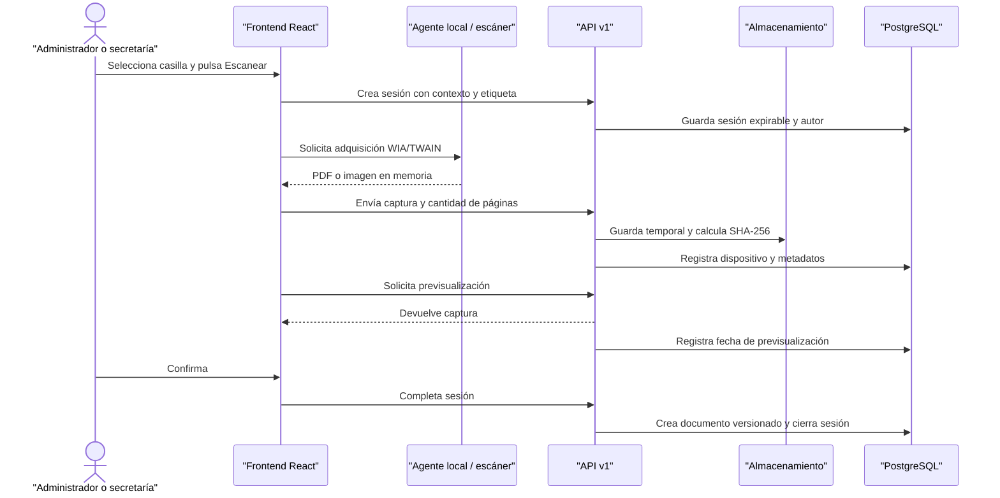

# Integración de escáner

## Decisión arquitectónica

El escaneo directo no pertenece exclusivamente al frontend ni al backend. Es
una integración híbrida:

- el escáner está conectado a la computadora del usuario y solo un componente
  ejecutado en esa estación puede utilizar su controlador;
- React inicia el flujo, muestra dispositivos, configuración, progreso,
  previsualización y confirmación;
- un agente local o tecnología compatible adquiere el archivo sin pedir al
  usuario guardarlo manualmente;
- la API controla autorización, sesión, vigencia, recepción, validación,
  previsualización registrada, confirmación, versión y auditoría.

Windows documenta que WIA enumera y adquiere desde escáneres instalados
localmente. WebUSB no se adopta como base porque su disponibilidad entre
navegadores continúa siendo limitada. La elección concreta debe hacerse luego
de inventariar modelos, drivers y estaciones:

- https://learn.microsoft.com/en-us/windows/apps/develop/devices-sensors/scan-from-your-app
- https://learn.microsoft.com/en-us/windows-hardware/drivers/image/wia-components
- https://developer.mozilla.org/en-US/docs/Web/API/WebUSB_API

## Secuencia end-to-end



## Contrato del frontend o agente local

1. Autenticarse mediante la sesión normal de la aplicación.
2. Crear la sesión antes de activar el dispositivo.
3. Enviar `AcquisitionProvider`, identificador/nombre del dispositivo,
   resolución, color y dúplex cuando el controlador los provea.
4. Producir un único PDF multipágina o una imagen para la casilla. La API
   admite PDF, JPEG, PNG y WebP y valida firma binaria, MIME y tamaño.
5. Mantener el archivo en memoria o almacenamiento temporal administrado por el
   agente; no presentar un diálogo obligatorio de Guardar como.
6. Cargar nuevamente dentro de la misma sesión cuando el usuario repita el
   escaneo. La captura anterior se elimina.
7. Mostrar siempre la respuesta de `/preview` antes de habilitar Confirmar.
8. Reportar errores estables como `DEVICE_NOT_FOUND`, `PAPER_JAM`,
   `COVER_OPEN`, `CANCELLED_BY_USER` o `ACQUISITION_FAILED`, preservando el
   mensaje original del controlador.

## Reglas implementadas en backend

- permiso separado `scanner.use`;
- propiedad de la sesión por usuario;
- contexto documental validado al crear y confirmar;
- reemplazo solamente de la versión vigente con misma casilla y contexto;
- 75 a 1200 DPI y límite configurable de páginas;
- expiración por defecto a los 30 minutos;
- previsualización obligatoria después de la última captura;
- documento definitivo con `Source=Scanner` y SHA-256;
- limpieza periódica de sesiones abandonadas;
- registro de cancelación, error, usuario, dispositivo y fechas;
- trazabilidad HTTP adicional mediante el middleware global.

## Agente Windows implementado

El proyecto `tools/BufeteJuridico.ScannerAgent` implementa un servicio local
ASP.NET Core 10 enlazado únicamente a `127.0.0.1:17654`. Expone `/health` y
`/scan`, limita CORS a los orígenes locales configurados y ejecuta la adquisición
WIA en un hilo STA. React detecta el agente, solicita resolución y modo de color,
recibe la imagen en memoria y continúa con la sesión auditada de la API.

Inicio local:

```powershell
.\scripts\start-scanner-agent.ps1
```

Cuando el agente o un escáner WIA no están disponibles, la misma pantalla ofrece
cámara/archivo como contingencia. Ese recorrido también crea una sesión,
previsualiza y guarda el resultado con `Source=Scanner`; no omite autorización,
validación, MinIO ni auditoría.

## Lo que depende de los equipos reales

El backend no puede determinar por sí solo si la universidad usará WIA,
TWAIN clásico, TWAIN Direct o un SDK del fabricante. Para cerrar el componente
local deben conocerse:

- marca y modelo de cada escáner;
- versión de Windows y arquitectura de las estaciones;
- disponibilidad de alimentador, dúplex y escaneo multipágina;
- drivers WIA/TWAIN instalados;
- navegadores autorizados y permisos de instalación;
- necesidad de firma del ejecutable y actualización automática.

Estas decisiones cambian el agente de adquisición, no el contrato de la API ni
el modelo documental.
