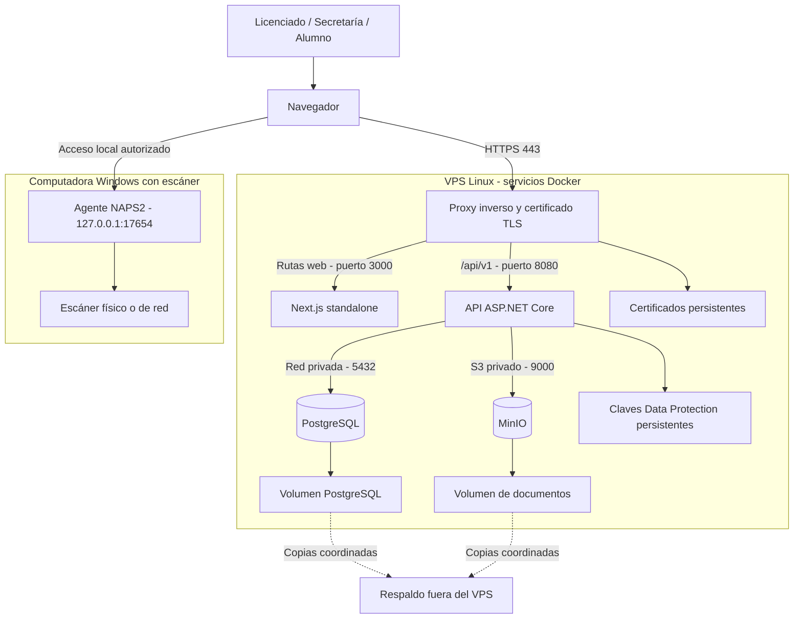
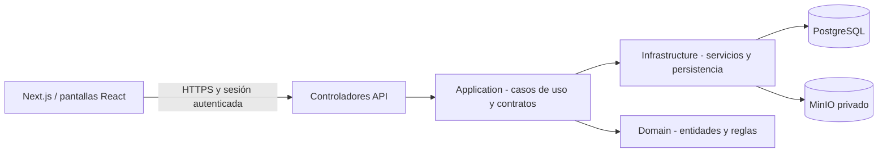

# Capítulo VI. Despliegue del sistema Bufete Popular UMG

**Fecha de preparación:** 16 de octubre de 2026.
**Destino definido por el responsable del proyecto:** VPS con los servicios del servidor desplegados mediante Docker.
**Versión objeto de entrega:** sistema principal, frontend Next.js y backend ASP.NET Core; no el adaptador de demostración de Vercel.
**Estado de este documento:** arquitectura y procedimiento preparados a partir del repositorio. No se recibió acceso, proveedor, IP ni dominio del VPS; por tanto, no se acredita todavía un despliegue productivo en ese servidor.

## 1. Respuesta para compartir con el equipo

> La entrega se plantea con el sistema principal del Bufete Popular UMG, desplegado en un VPS mediante Docker. En el servidor se ejecutarán el frontend Next.js, la API ASP.NET Core, PostgreSQL y MinIO para los documentos, junto con un proxy inverso que atenderá el dominio por HTTPS. La base de datos y MinIO se comunicarán con la API a través de la red privada de Docker. Los archivos se guardarán en un bucket privado con volumen persistente; PostgreSQL tendrá su propio volumen. La publicación existente en Vercel es un entorno separado y sus servicios Neon y Vercel Blob no describen la infraestructura final del VPS. El proveedor, dominio definitivo, certificado y capturas de pruebas del VPS se incorporarán cuando se realice y verifique esa publicación. El agente de escaneo se ejecuta en cada computadora Windows que utiliza un escáner, fuera del VPS.

## 2. Respuesta a cada información solicitada

| Solicitud del equipo | Información para el capítulo | Estado |
|---|---|---|
| Versión final | Sistema principal: Next.js + API ASP.NET Core + PostgreSQL + almacenamiento S3 compatible mediante MinIO. | Destino definido; publicación VPS pendiente de acreditar. |
| Frontend: proveedor y enlace | Alojado en el VPS contratado, contenedor `web`, servidor Next.js standalone. Acceso por el dominio HTTPS definitivo. | Proveedor y URL real pendientes. |
| Backend/API: proveedor y dirección | Mismo VPS, contenedor `api`, ASP.NET Core 10. Propuesta: `https://<DOMINIO>/api/v1`. | Dominio y prueba externa pendientes. |
| Base de datos | PostgreSQL 18, contenedor `postgres`, conexión privada de la API a `postgres:5432`, usando EF Core/Npgsql. | Implementación en repositorio; despliegue y restauración VPS pendientes. |
| Documentos | MinIO compatible con S3, bucket privado `bufete-documentos`, volumen persistente. API accede a `http://minio:9000`. | Implementación existente; almacenamiento VPS por verificar. |
| Configuración | Variables, CORS, dominios, proxy, migraciones y procedimiento descritos abajo; no se distribuyen secretos. | Especificación preparada. |
| HTTPS | Terminación TLS en proxy inverso, certificado válido para el dominio final y renovación configurada. | No hay certificado VPS aportado ni verificado. |
| Pruebas publicadas | Acceso, creación, refresco, recuperación, documentos, permisos y evidencias según matriz de esta entrega. | Deben ejecutarse contra el dominio VPS real. |

**Convención:** `<DOMINIO>`, `<PROVEEDOR_VPS>` e `<IP_PUBLICA_VPS>` son campos por completar, nunca direcciones o servicios ya contratados. No presentar una captura de Vercel o localhost como evidencia del VPS.

## 3. Componentes y distribución

| Componente | Tecnología observada en el repositorio | Función | Puerto dentro de Docker | Exposición propuesta |
|---|---|---|---|---|
| Proxy inverso | Servicio por incorporar al despliegue; propuesta Nginx con gestión de certificados | Recibir tráfico, terminar HTTPS y dirigirlo a web/API | 80 y 443 | Público |
| Frontend | Next.js, React 19, TypeScript; imagen Node.js 24 Alpine | Interfaz de administración, secretaría y alumnos | 3000 | Sólo a través del proxy |
| API | ASP.NET Core 10; capas Api, Application, Domain e Infrastructure | Autenticación, permisos, reglas, operaciones y archivos | 8080 | Sólo a través del proxy |
| Base de datos | PostgreSQL 18; imagen Compose actual `postgres:18.6-alpine3.24` | Registros, relaciones, sesiones, auditoría y metadatos | 5432 | Red privada |
| Objetos | MinIO; imagen Compose actual `RELEASE.2025-09-07T16-13-09Z` | Binarios de documentos y páginas de digitalización | 9000; consola 9001 | Red privada; consola sólo administración restringida |
| Inicialización de bucket | Cliente MinIO `mc` | Crear bucket si falta y establecer acceso privado | No requiere puerto publicado | Tarea puntual |
| Migraciones | Imagen de la API con argumento `--migrate` | Actualizar esquema y datos iniciales | No requiere puerto publicado | Tarea puntual previa a servir tráfico |
| Agente de escaneo | .NET/NAPS2, WIA/TWAIN/eSCL | Obtener páginas desde dispositivos de la estación | 17654 en loopback | Sólo computadora del usuario |

Las versiones listadas son las del código inspeccionado, no una certificación de actualización o seguridad del VPS. Antes de publicar, registrar las etiquetas/digests exactos de las imágenes realmente utilizadas.

Un solo VPS reúne aplicación, datos y almacenamiento: una caída del servidor puede detener el conjunto. Esta entrega describe un despliegue de instancia única y no debe calificarse como alta disponibilidad. La arquitectura de alta disponibilidad del repositorio es una evolución distinta, con redundancia y pruebas de recuperación adicionales.

## 4. Diagrama de despliegue



El navegador consume la API mediante el proxy público. Los nombres `api`, `postgres` y `minio` son resoluciones internas de Docker, no direcciones que deba abrir el usuario final.

## 5. Arquitectura lógica y flujo de datos



Este diagrama representa el flujo de ejecución. Las dependencias de proyectos son: Api → Application e Infrastructure; Infrastructure → Application y Domain; Application → Domain; Domain no depende de otras capas del sistema.

### Base de datos y sedes

La sede Petén conserva la base central. El módulo multi-sede nativo crea una base PostgreSQL independiente por sede nueva, usando el mismo esquema y migraciones. El servidor determina la conexión autorizada; el usuario no introduce cadenas de conexión. La cuenta global está controlada desde la plataforma y no se convierte en global por asignar un rol desde el frontend.

La implementación actual utiliza la identidad PostgreSQL configurada en la API para crear nuevas bases, por lo que requiere capacidad `CREATEDB` cuando se habilita la creación de sedes. La separación entre una identidad de aprovisionamiento y otras de operación debe diseñarse e implementarse antes de describirla como existente. No usar la identidad superusuario de PostgreSQL como cuenta operativa sólo por comodidad.

### Documentos

Los registros y metadatos documentales residen en PostgreSQL; los archivos binarios residen en MinIO. La API valida permisos y asociación al propietario/requisito. Los documentos nuevos incluyen el contexto de sede en su clave de almacenamiento; los históricos de Petén conservan sus claves.

Para este diseño con MinIO interno se propone `Storage__S3__UsePresignedUrls=false`: la API recupera y entrega el archivo autorizado. De esa manera el navegador no recibe enlaces a `http://minio:9000`, que no es accesible desde Internet. El bucket permanece privado. No hace falta publicar la consola MinIO ni abrir su API al usuario final.

El ciclo a verificar es: adquirir/cargar → revisar páginas → aceptar → almacenar → asociar → registrar metadatos/historial → visualizar → descargar → recuperar tras refrescar.

## 6. Direcciones y red propuestas

| Uso | Dirección objetivo |
|---|---|
| Acceso al sistema | `https://<DOMINIO>/acceso` |
| Inicio | `https://<DOMINIO>/` |
| Base API | `https://<DOMINIO>/api/v1` |
| Disponibilidad API | `https://<DOMINIO>/health/ready`, si se decide exponer esta ruta de monitoreo |
| Vida del proceso API | `/health/live`, preferentemente para monitoreo controlado |
| PostgreSQL desde API | `postgres:5432` |
| MinIO desde API | `http://minio:9000` |
| Escáner desde el navegador | `http://127.0.0.1:17654` en la estación del usuario |

El proxy debe conservar el prefijo `/api/v1` al reenviar solicitudes. Las rutas web restantes se dirigen a `web:3000`; no deben caer en la API. El DNS del dominio se configura hacia la IP pública del VPS. Si existe registro IPv6, también debe corresponder a un destino atendido y comprobado.

Abrir públicamente HTTP/HTTPS para acceso y emisión/renovación del certificado según el mecanismo elegido. Restringir SSH a administración autorizada. No publicar PostgreSQL, API interna ni MinIO en interfaces públicas. Comprobar desde fuera del servidor qué puertos son accesibles, incluidas las reglas que crea Docker.

## 7. Variables y configuración, sin secretos

### Frontend: valores públicos incorporados al construir

| Nombre | Propósito / valor de referencia |
|---|---|
| `NEXT_PUBLIC_API_BASE_URL` | `https://<DOMINIO>/api/v1`; nunca localhost para la API pública. |
| `NEXT_PUBLIC_SCANNER_AGENT_URL` | `http://127.0.0.1:17654`; aquí localhost sí corresponde al agente de la estación. |
| `NEXT_PUBLIC_DEMO_MODE` | Ausente o `false`; no activar el adaptador Vercel. |
| `NODE_ENV` | `production` en el contenedor final. |
| `HOSTNAME` / `PORT` | El Dockerfile final usa `0.0.0.0` y `3000`. |

Los dos argumentos de URL están admitidos por `frontend/Dockerfile`. Cambiar la URL pública requiere reconstruir la imagen, no únicamente reiniciar un contenedor con otra variable. No incluir contraseñas, tokens de almacenamiento ni claves JWT en variables `NEXT_PUBLIC_*`.

### API

| Nombre o grupo | Uso |
|---|---|
| `ASPNETCORE_ENVIRONMENT` | `Production`. |
| `ASPNETCORE_HTTP_PORTS` | `8080`, interno. |
| `AllowedHosts` | Host público exacto; sin `*`. Ajustar también la estrategia de probes internos para que su Host sea admitido. |
| `Cors__AllowedOrigins__0` | `https://<DOMINIO>`; origen exacto, sin ruta `/api/v1`. |
| `ReverseProxy__KnownProxies__0` | Dirección interna estable del proxy, verificada dentro de la red Docker. |
| `ConnectionStrings__BufeteDb` | Conexión privada a PostgreSQL; contiene credenciales secretas. |
| `Database__ApplyMigrationsOnStartup` | `false`; usar una ejecución explícita de migración. |
| `Jwt__Issuer`, `Jwt__Audience` | Identificador del emisor y aplicación destinataria. |
| `Jwt__SigningKey` | Secreto de firma, generado y custodiado fuera del repositorio. |
| `Jwt__AccessTokenMinutes`, `Jwt__RefreshTokenDays` | Duración de sesiones según política; referencia del repositorio 15 minutos y 7 días. |
| `BootstrapAdmin__Username`, `BootstrapAdmin__Email`, `BootstrapAdmin__FullName`, `BootstrapAdmin__Password` | Inicialización administrativa; contraseña secreta. |
| `PlatformAdmin__Email`, `PlatformAdmin__Password` | Inicialización explícita de cuenta global; contraseña secreta. |
| `RateLimiting__Authentication__PermitLimit`, `RateLimiting__Authentication__WindowSeconds` | Referencia: 10 intentos por ventana de 60 segundos. |
| `Storage__Provider` | `S3`. |
| `Storage__S3__BucketName`, `Storage__S3__Region` | Bucket privado y región lógica. |
| `Storage__S3__ServiceUrl` | `http://minio:9000` dentro de Docker. |
| `Storage__S3__ForcePathStyle` | `true` para la configuración MinIO propuesta. |
| `Storage__S3__UsePresignedUrls` | `false` para entregar documentos a través de la API. |
| `Storage__S3__AccessKey`, `Storage__S3__SecretKey` | Credenciales del servicio de almacenamiento; usar identidad de aplicación con permisos necesarios. |
| `Storage__S3__KeyPrefix` | Prefijo lógico, referencia `bufete`. |
| `Storage__MaxFileSizeBytes`, `Storage__DownloadUrlMinutes` | Referencia: 26 214 400 bytes y 2 minutos; coordinar límites con proxy y frontend. |
| `Scanner__SessionMinutes`, `Scanner__MaximumPages`, `Scanner__CleanupIntervalMinutes`, `Scanner__DraftRetentionDays` | Referencia de configuración: 30 minutos, 200 páginas, 15 minutos y 30 días. |
| `Smtp__Enabled`, `Smtp__Host`, `Smtp__Port`, `Smtp__UseSsl`, `Smtp__Username`, `Smtp__Password`, `Smtp__FromAddress`, `Smtp__FromName` | Correo institucional opcional; requiere servidor/cuenta reales y prueba de envío. |

Plantilla conceptual de conexión — no contiene una contraseña utilizable:

```text
Host=postgres;Port=5432;Database=<BASE_CENTRAL>;Username=<USUARIO_APP>;Password=<SECRETO>;Maximum Pool Size=30;Minimum Pool Size=2
```

### PostgreSQL, MinIO y agente

| Variables | Observación |
|---|---|
| `POSTGRES_DB`, `POSTGRES_USER`, `POSTGRES_PASSWORD` | Inicialización del contenedor; custodiar la contraseña. Cambiar la variable no cambia automáticamente credenciales de una base ya inicializada. |
| `MINIO_ROOT_USER`, `MINIO_ROOT_PASSWORD` | Administración de MinIO; no publicarlas ni distribuirlas en manuales. |
| `MINIO_BUCKET` | Inicialización del bucket privado. |
| `SCANNER_ALLOWED_ORIGINS` | Dominios web autorizados en el agente local; agregar el dominio real del VPS. |

En ASP.NET Core `__` representa separación de secciones. En Production la aplicación no carga automáticamente el `.env` local: Compose o el mecanismo de secretos debe inyectar la configuración. No suponer que existe soporte `_FILE` para todas las opciones; hay que comprobarlo o implementarlo si se usan archivos de secretos. El archivo de variables del servidor debe quedar fuera del repositorio, con permisos restringidos y sin aparecer en capturas o logs.

## 8. CORS, HTTPS y proxy

Con frontend y API bajo el mismo dominio, las llamadas principales son del mismo origen. Aun así, la API exige configurar una lista de orígenes; debe contener el dominio HTTPS exacto. No mantener los orígenes localhost del Compose local como configuración final ni usar comodines para resolver errores.

El proxy debe enviar correctamente `Host`, `X-Forwarded-For` y `X-Forwarded-Proto`. La API sólo debe confiar en el proxy configurado. Debe comprobarse que reconoce el esquema externo HTTPS y no genera bucles de redirección. El health check actual del Dockerfile usa HTTP local: al pasar a Production, revisar Host admitido y comportamiento de redirección, y verificar que la comprobación valida el contenido saludable y no sólo una respuesta 3xx.

La evidencia HTTPS debe incluir dominio, emisor del certificado, fechas de validez, cadena confiable, redirección de HTTP a HTTPS y acceso sin advertencias. La renovación necesita una prueba operativa y almacenamiento persistente de certificados/estado del cliente ACME. No se adjunta un certificado ficticio ni se reutiliza el de Vercel como prueba del VPS.

## 9. Adaptaciones necesarias de los archivos actuales

`compose.yaml` y `compose.app.yaml` acreditan ejecución Docker local; no constituyen un manifiesto productivo listo para copiar.

1. Crear un manifiesto independiente de producción, por ejemplo `compose.prod.yaml`, evitando heredar inadvertidamente puertos y opciones de desarrollo.
2. Agregar proxy HTTPS y gestión de certificados persistentes; definir DNS y red interna.
3. Cambiar API a Production; dominios y proxies explícitos; migraciones al arranque desactivadas.
4. Construir web con la URL HTTPS real de API y modo demo desactivado.
5. Corregir la inicialización MinIO: el Compose local usa `host.docker.internal`; dentro del VPS utilizar directamente `http://minio:9000`.
6. Crear credenciales de aplicación para MinIO y bucket privado; el Compose local comparte credenciales raíz con la API y esa elección debe sustituirse para producción.
7. Definir volúmenes para PostgreSQL, MinIO, certificados y claves Data Protection. Cifrar/proteger claves y respaldarlas; la persistencia sola no equivale a cifrado.
8. Revisar health checks, dependencias, permisos de volúmenes, reinicio y rotación de logs.
9. Configurar backup externo y validar restauración de todas las bases de sedes y archivos.
10. Ejecutar las pruebas de aceptación del dominio antes de declarar operativo el VPS.

**No se creó ni se ejecutó aquí un `compose.prod.yaml`:** estas adaptaciones se especifican para la implementación del despliegue. Tampoco se modificaron datos o servicios remotos durante la preparación de este capítulo.

## 10. Procedimiento de publicación

### Preparación

1. Registrar proveedor, plan, región, sistema operativo, CPU/RAM/disco y responsable técnico del VPS contratado. Dimensionar con pruebas de carga, concurrencia y volumen documental; el repositorio no acredita una capacidad garantizada.
2. Preparar el acceso administrativo, Docker Engine y Compose; registrar sus versiones reales.
3. Configurar dominio/DNS y reglas de red; comprobar puertos públicos desde otra red.
4. Elegir una versión del repositorio y registrar commit/tag y digests de imágenes. Excluir `.env`, documentos reales, respaldos y credenciales del contexto de build.
5. Preparar el manifiesto productivo, variables privadas y permisos de almacenamiento según las secciones anteriores.

### Construcción, datos y arranque

Los siguientes comandos son una plantilla para cuando exista el manifiesto productivo; no deben ejecutarse ahora contra archivos inexistentes ni interpretarse como evidencia de una publicación ya hecha:

```bash
docker compose --env-file .env.production -f compose.prod.yaml config --quiet
docker compose --env-file .env.production -f compose.prod.yaml build api web
docker compose --env-file .env.production -f compose.prod.yaml up -d postgres minio
docker compose --env-file .env.production -f compose.prod.yaml run --rm minio-init
docker compose --env-file .env.production -f compose.prod.yaml run --rm --no-deps api --migrate
docker compose --env-file .env.production -f compose.prod.yaml up -d api web proxy
docker compose --env-file .env.production -f compose.prod.yaml ps
```

El servicio `proxy` y los nombres aquí usados deberán coincidir con el manifiesto que se implemente. La API dispone realmente del argumento `--migrate`, que termina después de migrar/sembrar; la ruta multi-sede incluye las bases registradas. Verificar código de salida y logs antes de iniciar tráfico. Si el trabajo falla, detener la publicación y resolver la causa; no continuar por ver un contenedor en estado running.

Configurar/empezar la emisión del certificado según el proxy elegido; abrir el dominio sólo cuando web/API y TLS estén listos. Si se van a trasladar datos locales, hacerlo mediante respaldo y restauración coherente de PostgreSQL y MinIO. La estructura JSON de la demo Vercel no es equivalente al modelo nativo: sus datos requieren una migración diseñada y validada, no una conexión directa cambiando una URL.

### Verificación externa

Abrir `https://<DOMINIO>/acceso` desde un equipo distinto al VPS. Iniciar sesión con sede/credenciales autorizadas, ejecutar la matriz siguiente y revisar consola, tráfico de red y logs. No adjuntar tokens o datos personales reales al informe.

## 11. Escaneo en el despliegue final

Docker en el VPS aloja servicios del servidor; no proporciona por sí solo acceso al escáner conectado al escritorio de secretaría. El navegador utiliza el agente NAPS2 local con los controladores instalados en Windows. La configuración actual contempla WIA, TWAIN y eSCL.

Preparar en cada estación: controladores adecuados, agente, dominio VPS en `SCANNER_ALLOWED_ORIGINS` y un método de inicio gestionado. La instalación y el arranque automático en todas las estaciones son tareas de implementación/operación pendientes de acreditar; no afirmar que el dominio instala software silenciosamente.

Probar desde el dominio final la detección, los permisos de acceso local del navegador cuando correspondan, una captura física, revisión de páginas, guardado, asociación, refresco, vista previa y descarga. Un `/health` correcto o una lista de dispositivos no demuestra captura ni almacenamiento completo.

## 12. Evidencias de aceptación requeridas

Usar registros QA identificables y autorizados, no datos personales reales. Cada evidencia debe contener fecha, dominio, versión, actor, pasos, resultado esperado y observado. Mantener capturas y logs sanitizados en una carpeta de entrega.

| ID | Prueba | Resultado exigido | Evidencia |
|---|---|---|---|
| E01 | Abrir dominio HTTPS desde otra red | Acceso sin advertencias ni recursos fallidos | Captura de acceso y URL. |
| E02 | Inspeccionar certificado y entrar por HTTP | Certificado válido; HTTP redirige a HTTPS | Emisor, fechas y prueba de redirección. |
| E03 | Revisar servicios y salud | Contenedores y dependencias saludables, no sólo running | Salida `ps`, health y logs sin secretos. |
| E04 | Iniciar sesión con sede válida | Permisos correctos y nombre de sede correcto | Captura posterior al acceso. |
| E05 | Crear cliente QA y registrar su identificador | Operación persistida | Confirmación, registro y resultado de API. |
| E06 | Refrescar y volver a abrir ese cliente | Mismos datos recuperados del servidor | Captura después de refresco; consulta de DB autorizada sin secretos. |
| E07 | Abrir expediente para ese cliente | Relación y uso posterior correctos | Detalle de cliente/expediente e histórico. |
| E08 | Adjuntar archivo a un requisito | Metadatos y objeto guardados y asociados | Captura del requisito, DB y objeto privado. |
| E09 | Refrescar, previsualizar y descargar | Archivo recuperable y contenido correcto | Captura y comparación de integridad cuando aplique. |
| E10 | Capturar desde escáner físico | Ciclo documental completo desde el dominio | Dispositivo, páginas, guardado y recuperación. |
| E11 | Secretaría/alumno intentan acción global | Acceso rechazado por servidor | Respuesta 403 y ausencia de operación persistida. |
| E12 | Intentar acceso cruzado entre sedes | Datos ajenos inaccesibles | Prueba con dos sedes QA y permisos controlados. |
| E13 | Reiniciar servicios con registro QA existente | Persistencia intacta | Recuperación de registro y archivo tras reinicio. |
| E14 | Restaurar backup en entorno aislado | Bases, relaciones y archivos recuperables | Acta de restauración y tiempos medidos. |
| E15 | Revisar errores recuperables | Mensajes claros; sin errores imprevistos de consola/red | Validación de formulario, carga fallida y revisión de logs. |

Las pruebas locales históricas y las de Vercel son antecedentes útiles, pero no sustituyen E01–E15 en el VPS. No marcar como aprobadas las pruebas no ejecutadas.

## 13. Respaldos, actualización y operación

- Respaldar base central y cada base de sede, roles/configuración necesaria, objetos MinIO y claves/certificados pertinentes. Guardar copias cifradas en una ubicación diferente al VPS.
- Coordinar captura de metadatos y objetos: definir ventana sin escrituras o un mecanismo consistente y probarlo. Copiar un volumen de PostgreSQL en caliente sin un procedimiento compatible no acredita un respaldo válido.
- Definir con el responsable la frecuencia, retención, RPO (pérdida de datos tolerada) y RTO (tiempo de recuperación). Este documento no inventa acuerdos aprobados.
- Antes de actualizar: respaldo recuperable, versión anterior disponible y revisión de compatibilidad de migraciones. Después: aplicar migraciones una vez, desplegar imágenes y repetir pruebas prioritarias.
- Revertir la imagen no revierte automáticamente el esquema de base. Planificar rollback compatible o restauración controlada; documentar pérdida de datos potencial antes de una restauración.
- Supervisar salud, espacio de disco, memoria, CPU, conexiones PostgreSQL, crecimiento de documentos, fallos de backup y vencimiento/renovación TLS. Docker puede reiniciar procesos; no elimina la necesidad de monitoreo.
- No utilizar `docker compose down -v` como procedimiento normal de actualización: eliminaría volúmenes y puede destruir los datos persistentes.

## 14. Datos que faltan para cerrar el capítulo como despliegue realizado

| Campo | Valor |
|---|---|
| Proveedor y plan VPS | PENDIENTE |
| Región y sistema operativo | PENDIENTE |
| CPU, RAM y almacenamiento contratado | PENDIENTE |
| IP pública y dominio definitivo | PENDIENTE; no publicar acceso SSH ni credenciales |
| URL real frontend y API | PENDIENTE |
| Proxy y mecanismo de certificados elegidos | PENDIENTE |
| Commit/tag y digests de imágenes desplegadas | PENDIENTE |
| Fecha de publicación y responsable | PENDIENTE |
| Evidencia de certificado y renovación | PENDIENTE |
| Destino de respaldo, política y restauración probada | PENDIENTE |
| Resultados E01–E15 | PENDIENTE de ejecución en VPS |

## 15. Fuentes inspeccionadas

Rutas relativas a la raíz del repositorio:

- `README.md`: arquitectura, ejecución Docker y límites del Compose local.
- `compose.yaml`, `compose.app.yaml`: servicios, red, volúmenes y configuración local.
- `Dockerfile.api`, `frontend/Dockerfile`, `frontend/.dockerignore`: construcción, puertos, usuarios y exclusión de secretos.
- `.env.example`, `frontend/.env.example`, `src/BufeteJuridico.Api/appsettings.json`: nombres de configuración.
- `src/BufeteJuridico.Api/Program.cs`: CORS, forwarded headers, migraciones, HTTPS y health checks.
- `src/BufeteJuridico.Api/Infrastructure/Configuration/ProductionConfigurationValidator.cs`: exigencia de hosts, proxy y proveedor S3.
- `src/BufeteJuridico.Infrastructure/Tenancy/TenantRegistry.cs`: creación de bases por sede.
- `src/BufeteJuridico.Infrastructure/Documents/S3FileStorage.cs`: entrega y URLs de documentos.
- `docs/arquitectura/10_MULTITENANCY_NATIVO.md`: contexto multi-sede y verificaciones locales históricas.
- `docs/arquitectura/09_ARQUITECTURA_PRODUCCION_ALTA_DISPONIBILIDAD.md`: arquitectura redundante y límites frente a un solo VPS.
- `scripts/start-scanner-agent.ps1`: arranque del agente local y orígenes admitidos.

**Resultado de preparación:** las ocho solicitudes de las imágenes están respondidas con diseño, configuración, procedimiento, diagramas y evidencia exigida. La inspección fue documental y de código; no se ejecutó un despliegue VPS, no se verificó un dominio VPS y no se generaron capturas que pretendan demostrarlo.
